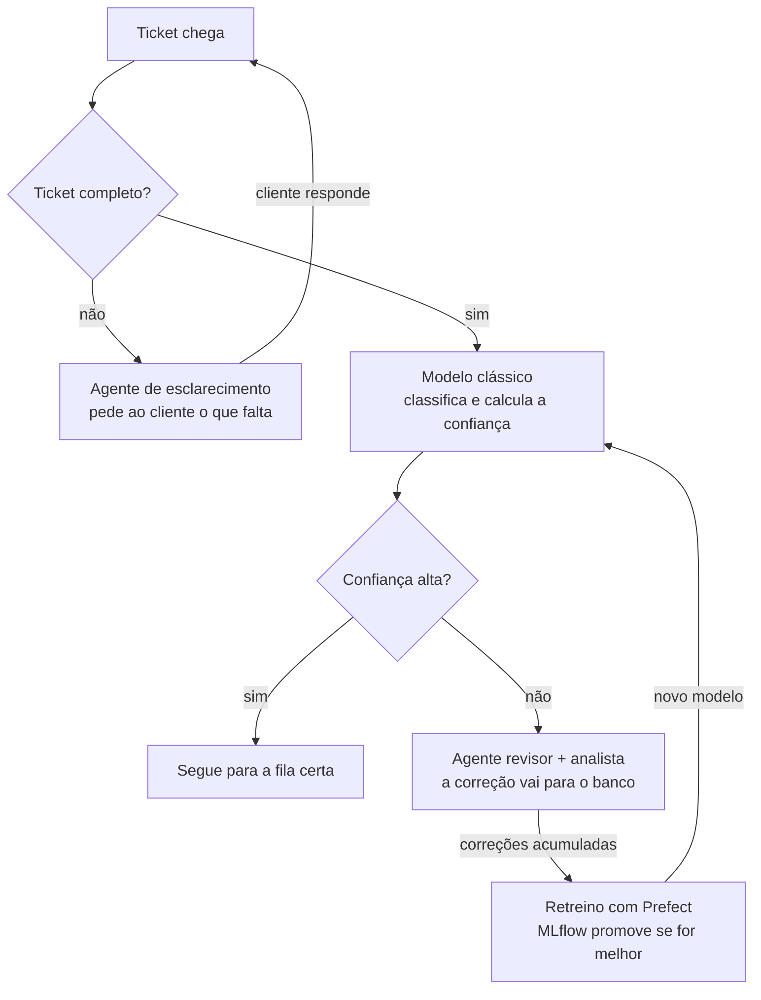

# TicketFlow

Triagem automática de chamados de suporte: classifica cada ticket por **fila** e **prioridade**, pede ao cliente o que
falta quando o ticket está incompleto e **aprende com as correções dos atendentes**.

> **Status: em construção.** A fundação está pronta: decisões de arquitetura, estrutura do repositório e exploração
> do dataset. O próximo passo é o modelo clássico (ver [Roadmap](#14-roadmap)). As seções marcadas como *planejado*
> descrevem o desenho, não resultados.

**Em resumo**, o projeto demonstra os dois diferenciais mais pedidos em vagas de ML/IA:

- **ML em produção:** classificador versionado no MLflow, monitoramento de drift com Evidently e retreino orquestrado
  pelo Prefect. Um modelo novo só substitui o atual se ganhar dele (*champion/challenger*).
- **Agentes de IA:** quatro agentes orquestrados pelo LangGraph, cada um com ferramentas e limites próprios, e
  aprovação humana nos pontos de risco.
- **Custo sob controle:** o modelo clássico decide os casos fáceis a custo quase zero. Só os casos de baixa confiança
  gastam LLM ou tempo de analista.
- **Decisões medidas, não supostas:** a exploração do dataset já mudou três premissas do projeto (ver
  [Dataset](#5-dataset)).

> **Transparência:** o projeto aplica práticas de produção num cenário simulado, com um dataset público e sintético.
> Ele não tem a escala de uma empresa real, por isso mede os próprios limites com teste de carga em vez de supor.

---

## 1. O problema de negócio

Empresas recebem milhares de tickets por dia, e alguém precisa ler cada um para decidir quem resolve. Sem triagem,
um cliente cobrado em dobro pode esperar dias atrás de uma dúvida simples, e o time certo só descobre o problema
quando o prazo já estourou.

> **Pergunta central:** quantos tickets dá para encaminhar sozinho, com qual acerto, e quanto custa cada um?

| Área | Pergunta | Decisão apoiada |
|---|---|---|
| Operação de suporte | Para qual fila vai este ticket, e com que urgência? | Encaminhamento sem leitura manual |
| Operação de suporte | Este ticket tem informação suficiente para ser resolvido? | Pedir dados ao cliente antes de ocupar um analista |
| Coordenação | Quais tickets vão estourar o SLA? | Escalar antes do prazo |
| Gestão | Quanto da triagem é automática, com qual acerto e a que custo por ticket? | Dimensionar o time e o orçamento de LLM |
| Time de ML | O modelo continua bom com os tickets que chegam hoje? | Retreinar só quando necessário |

## 2. Como funciona

O ticket incompleto volta ao cliente. O completo passa pelo modelo clássico, e só o de baixa confiança vai para o
LLM ou para o analista. As correções dos analistas alimentam o retreino.



| Ticket | Completo? | Modelo clássico | Resultado |
|---|---|---|---|
| "Fui cobrado duas vezes no cartão" | Sim | Financeiro, 96% | Segue direto para o financeiro |
| "O negócio travou, ajeitem logo" | Não | Não chega aqui | Agente pede sistema, print e passos ao cliente |
| "Após atualizar o app, fui cobrado de novo" | Sim | Financeiro, 55% | Revisor sugere, analista decide; a correção vira dado de retreino |

## 3. Prioridade e SLA

Os três níveis do dataset viram P2, P3 e P4. O **P1 vem só de regras de negócio**: um caso crítico não pode depender
de uma probabilidade.

| Nível | Nome | Critério | SLA alvo | Quem atribui |
|---|---|---|---|---|
| P1 | Crítica / Urgente | Sistema fora do ar, interrupção total do negócio, vazamento de dados ou bloqueio que impede o cliente de trabalhar | < 1 hora | Regras de negócio |
| P2 | Alta | Operação impactada significativamente, perda de funcionalidade importante sem alternativa | 4 a 8 horas | Modelo (`high`) |
| P3 | Média | Problema menor com alternativa disponível, ou dúvida de uso cotidiano | 24 horas | Modelo (`medium`) |
| P4 | Baixa / Planejada | Pedido de recurso, melhoria estética, dúvida teórica ou manutenção agendada | 48 a 72 horas | Modelo (`low`) |

## 4. Agentes

Quatro agentes orquestrados pelo LangGraph. **Regra para criar um agente:** ele só existe separado quando tem
responsabilidade, ferramentas ou permissões próprias. Quem redige a resposta ao cliente, por exemplo, não pode
escalar chamados.

| Agente | Faz | Ferramentas | Não pode |
|---|---|---|---|
| Esclarecimento | Detecta ticket incompleto e pede ao cliente o que falta | Enviar mensagem ao cliente | Classificar ou resolver |
| Revisor | Analisa os casos de baixa confiança e sugere a fila, com justificativa | Ler o ticket e as 2 filas mais prováveis do modelo | Encaminhar sozinho: o analista confirma |
| Resolução (RAG) | Busca tickets parecidos já resolvidos e redige a resposta | Busca na base de conhecimento | Enviar sem aprovação humana |
| SLA | Acompanha o prazo de cada prioridade e escala o que vai estourar | Consultar a fila e notificar o responsável | Alterar a classificação |

## 5. Dataset

[Tobi-Bueck/customer-support-tickets](https://huggingface.co/datasets/Tobi-Bueck/customer-support-tickets)
(licença CC BY-NC 4.0). Tickets de e-mail com assunto, corpo, fila, prioridade, tipo, tags e a resposta do
atendente, em inglês e alemão. A análise completa está em
[`notebooks/01_exploracao_dataset.ipynb`](notebooks/01_exploracao_dataset.ipynb).

**O que a exploração mudou nas premissas do projeto:**

| Premissa inicial | O que os dados mostraram | Consequência |
|---|---|---|
| 61.765 tickets | É a soma de três arquivos incompatíveis: um tem outra taxonomia (42 temas, só alemão) e outro é uma versão anterior que repete 8.399 tickets | Base do projeto: **v5, 28.587 tickets**. Juntar as versões criaria duplicatas entre treino e teste |
| Dataset real, ao contrário do Bitext | Também é sintético, gerado por LLM pela autora do dataset | Escolha mantida por outros motivos: dois idiomas, prioridade, resposta do atendente e mais variedade de texto |
| O modelo resolve a maioria; o LLM só os casos difíceis | Um baseline TF-IDF acerta 59% das 10 filas. Com meta de 95% de acerto, automatiza só ~8% dos tickets | A meta de acerto e o papel do LLM viram decisões a medir, não a supor (ver [Pendências](#15-pendências)) |

**Outros achados:**

- As filas são desbalanceadas: *Technical Support* tem 29% dos tickets, *General Inquiry* tem 1,4%. O baseline
  joga as dúvidas na fila maior, e as filas pequenas têm recall baixo.
- Os rótulos têm ruído visível, por exemplo "Problem with Data Integration" na fila de *Sales and Pre-Sales*. Parte
  do erro é do rótulo, não do modelo.
- *high* é 39% dos tickets, então não é rara. O P1 continua vindo só de regras.
- `type`, `tags` e `answer` são preenchidos depois da triagem. **Não entram como features**, para não haver
  vazamento. A `answer` vira a base de conhecimento do agente de resolução.
- 904 tickets (3,2%) têm corpo com menos de 60 caracteres, como "description of the problem". São a base real
  para avaliar o detector de ticket incompleto.

## 6. Qualidade do modelo e retreino *(planejado)*

Toda decisão do modelo é medida, e um modelo novo só entra em produção se provar que é melhor.

- **Limiar de confiança:** o menor limiar cujo acerto nos tickets automáticos atinge a meta de negócio. Assim a
  automação é a maior possível sem perder qualidade.
- **Calibração:** diagrama de confiabilidade e ECE (erro de calibração esperado). Se o modelo estiver descalibrado,
  a correção é feita com `CalibratedClassifierCV`.
- **Gatilho de retreino:** drift detectado pelo Evidently, ou correções acumuladas acima de uma fração do conjunto de
  treino.
- **Portão champion/challenger:** o modelo novo só substitui o atual se ganhar num conjunto de teste fixo e nas
  correções recentes. Se perder, fica registrado no MLflow e o atual continua.
- **Drift simulado:** numa segunda fase, tickets em português são injetados de propósito, para mostrar o
  monitoramento detectando a mudança e o retreino resolvendo.

## 7. Métricas

| Tipo | Métrica | Por quê |
|---|---|---|
| Negócio | Taxa de automação | Quanto da triagem dispensa leitura humana |
| Negócio | Acerto nos tickets automáticos | A qualidade do que o sistema decide sozinho |
| Negócio | Custo por ticket | Modelo clássico, chamadas ao LLM e tempo de analista |
| Negócio | SLA cumprido por prioridade | O efeito final para o cliente |
| Modelo | F1 macro por fila e prioridade | A acurácia esconde as filas pequenas |
| Modelo | ECE e diagrama de confiabilidade | O limiar só funciona se a confiança for real |
| Agentes | Taxa de aceite das sugestões do revisor, latência e custo por chamada (Langfuse) | Medir se o agente ajuda o analista |

## 8. Arquitetura e stack

Tudo roda localmente com ferramentas open source. A AWS fica para depois que o sistema estiver completo
(ver [Futuras implementações](#16-futuras-implementações)).

| Camada | Tecnologia | Papel | Status |
|---|---|---|---|
| Base | Python 3.12 + uv | Todo o back-end numa linguagem só: as bibliotecas de ML, MLOps e agentes são nativas em Python | ✅ |
| Base | Docker Compose | Sobe o sistema inteiro com um comando | ✅ base |
| Base | PostgreSQL | Tickets, classificações e correções dos atendentes; também o backend do MLflow | ✅ base |
| ML em produção | scikit-learn | Classificadores de fila e prioridade, com probabilidade verificável | 🔜 |
| ML em produção | MLflow | Registro dos treinos e versionamento no Model Registry | ✅ base |
| ML em produção | Evidently | Detecção de drift: o gatilho do retreino | 🔜 |
| ML em produção | Prefect | Retreino: junta correções, treina, compara e só promove se for melhor | 🔜 |
| Agentes | LangGraph | Agentes como grafo com estado e aprovação humana no fluxo | 🔜 |
| Agentes | LLM via API | Qualidade nos casos difíceis; custo controlado pelo volume pequeno | 🔜 |
| Agentes | ChromaDB + embeddings | Base de conhecimento para a busca por similaridade (RAG) | 🔜 |
| Agentes | Langfuse | Tracing dos agentes, versionamento de prompts e avaliações | 🔜 |
| Interface | FastAPI | Expõe o sistema como API para outros softwares | 🔜 |
| Interface | Next.js + TypeScript | Tela do atendente: fila em tempo real e correção da classificação | 🔜 |
| Qualidade | pytest + GitHub Actions | Testes e avaliações a cada commit, para uma mudança de prompt não quebrar o sistema | 🔜 |

## 9. Principais decisões

| Decisão | Escolha | Por quê |
|---|---|---|
| Tema | Triagem de chamados de suporte | Caso que toda empresa reconhece; as correções dos atendentes dão um sinal natural de retreino; diversifica o portfólio com NLP |
| Categorias | Filas (`queue`) do dataset | Os rótulos já existem, e cada fila é um time que resolve |
| Quem classifica | Híbrido: modelo clássico primeiro, LLM só com confiança baixa | Custo quase zero nos casos fáceis; confiança calculada e verificável; existe um modelo para retreinar |
| Prioridade | Modelo prevê baixa, média ou alta; regras elevam para P1 | Um caso crítico não pode depender de uma probabilidade |
| Ticket incompleto | Tratado à parte, pelo agente de esclarecimento | Ticket incompleto pede informação ao cliente; modelo inseguro pede decisão a um analista. São problemas diferentes |
| Features do modelo | Só assunto e corpo | `type`, `tags` e `answer` só existem depois da triagem; usá-los seria vazamento |
| Versão do dataset | Só a v5 (28.587 tickets) | As outras versões repetem tickets ou usam outra taxonomia |
| LLM | Via API | Mais qualidade que um modelo local; o volume fica pequeno porque o LLM só atua nos casos difíceis |
| Nuvem | AWS adiada; tudo local com MLOps open source | Foco no sistema antes da infraestrutura; MLflow e Evidently funcionam em qualquer nuvem |
| Ambiente Python | uv com `pyproject.toml` e lockfile | Instalação reproduzível e rápida, com as versões exatas no `uv.lock` |
| Backend do MLflow | Banco `mlflow` no mesmo PostgreSQL | Um serviço a menos para subir, com o histórico isolado dos dados do produto |

## 10. Escala e desempenho *(planejado)*

- **Processamento em lote:** classificar os 28.587 tickets de uma vez e registrar o tempo total e por ticket.
- **Teste de carga da API:** simular tickets chegando ao mesmo tempo com o Locust e medir tickets por segundo e
  latência.
- **Gargalo:** identificar a etapa que limita o sistema (modelo, LLM ou banco) e documentar o que mudaria para escalar.

## 11. Segurança

- Nenhum token ou chave entra no repositório. O código lê credenciais de variáveis de ambiente, e o `.env` está no
  `.gitignore`; só o `.env.example`, sem valores reais, é versionado.
- Tokens e senhas ficam num gerenciador de senhas (Bitwarden ou KeePassXC).
- Um token que já apareceu em repositório, print ou mensagem é revogado e substituído.
- Na fase AWS: MFA no usuário root, usuário IAM com permissões mínimas, credenciais temporárias via IAM Identity
  Center e alerta no AWS Budgets.

## 12. Estrutura do repositório

```
src/ticketflow/        Pacote Python do projeto
  config.py            Caminhos e configurações lidas do .env
  data/load.py         Leitura do dataset com a limpeza mínima comum a todas as etapas
scripts/
  download_data.py     Baixa o dataset do Hugging Face para data/raw/
notebooks/
  01_exploracao_dataset.ipynb   Exploração do dataset e checagem de separabilidade
docker/                Imagem do MLflow e script de criação do banco
docs/                  Documento original de decisões (PDF)
data/                  raw/ e processed/, fora do Git
docker-compose.yml     PostgreSQL + MLflow
pyproject.toml         Dependências (uv)
```

## 13. Como reproduzir

Pré-requisitos: [uv](https://docs.astral.sh/uv/) e Docker Desktop.

```bash
uv sync                                   # cria o ambiente com as versões do uv.lock
cp .env.example .env                      # e troque a senha do Postgres
uv run python scripts/download_data.py    # baixa o dataset para data/raw/
docker compose up -d                      # PostgreSQL em :5432 e MLflow em http://localhost:5000
uv run jupyter lab notebooks/             # abre a exploração
```

## 14. Roadmap

- [x] **Fase 0 · Fundação**
  - [x] Problema de negócio e decisões de arquitetura
  - [x] Estrutura do repositório, ambiente (uv) e Docker Compose base (PostgreSQL + MLflow)
  - [x] Exploração do dataset e revisão das premissas
- [ ] **Fase 1 · Modelo clássico**
  - [ ] Divisão treino/validação/teste fixa e reproduzível
  - [ ] Baselines de fila e prioridade, com pesos de classe, registrados no MLflow
  - [ ] Comparação com embeddings multilíngues
  - [ ] Calibração (ECE) e escolha do limiar pela meta de acerto
  - [ ] Regras de P1 e mapeamento para P2–P4
  - [ ] Modelo campeão no Model Registry
- [ ] **Fase 2 · API e banco**
  - [ ] Esquema no PostgreSQL: tickets, classificações e correções
  - [ ] FastAPI: receber ticket, classificar e registrar correção
- [ ] **Fase 3 · Agentes**
  - [ ] Grafo no LangGraph com aprovação humana
  - [ ] Agente de esclarecimento, avaliado nos tickets curtos do dataset
  - [ ] Agente revisor, comparado ao modelo nos casos de baixa confiança
  - [ ] Agente de resolução com RAG sobre as respostas dos atendentes (ChromaDB)
  - [ ] Agente de SLA
  - [ ] Tracing e avaliações no Langfuse
- [ ] **Fase 4 · MLOps**
  - [ ] Monitoramento de drift com Evidently
  - [ ] Retreino no Prefect com portão champion/challenger
  - [ ] Drift simulado com tickets em português
- [ ] **Fase 5 · Interface e qualidade**
  - [ ] Tela do atendente em Next.js
  - [ ] Testes e avaliações no GitHub Actions
- [ ] **Fase 6 · Escala**
  - [ ] Processamento em lote, teste de carga com Locust e análise do gargalo
- [ ] **Fase 7 · Divulgação**
  - [ ] Artigo (SpecificData e LinkedIn)

## 15. Pendências

Decisões a fechar antes ou durante a implementação, com o que os dados já dizem sobre cada uma.

| Pendência | O que os dados dizem | Quando fechar |
|---|---|---|
| Meta de acerto nos tickets automáticos (define o limiar) | No baseline, 95% de acerto automatiza ~8% dos tickets; 90% automatiza ~17% | Fase 1, depois de testar modelos melhores |
| Quais filas viram categorias, e se as pequenas serão agrupadas | Agrupar as três filas de suporte sobe a acurácia de 59% para 74%, mas o F1 macro cai. O desbalanceamento continua | Fase 1 |
| Provedor e modelo do LLM (priorizar um modelo pequeno e barato) | O LLM pode receber a maior parte do volume, então o custo por ticket pesa mais que o previsto | Fase 3, comparando acerto e custo nos mesmos tickets |
| Regras que elevam um ticket para P1 | *high* é 39% dos tickets; as regras precisam ser estreitas para o P1 continuar raro | Fase 1 |
| Definição de "ticket incompleto" | 904 tickets têm corpo com menos de 60 caracteres | Fase 3 |
| Fração de correções que dispara o retreino | Sem dado ainda | Fase 4 |

## 16. Futuras implementações

A AWS é a primeira evolução, depois que o sistema estiver completo rodando local.

1. Deploy na AWS com S3, SQS, Lambda, EventBridge, CloudWatch e Bedrock, priorizando serviços cobrados por uso.
2. Infraestrutura como código com Terraform, para recriar o ambiente numa conta nova.
3. CI/CD com OIDC, para o GitHub Actions acessar a AWS sem chaves guardadas.
4. Shadow deployment: o modelo novo roda em paralelo ao atual até provar que é melhor.
5. Dashboard no Grafana: drift, custo por ticket e latência dos agentes.
6. Integração com uma ferramenta real de tickets (Jira Service Management ou Zendesk) via API.

### Simplificações conscientes

- O dataset é sintético e não tem data de abertura dos tickets. A divisão de treino e teste é aleatória
  estratificada, não temporal, e o drift é simulado.
- As correções dos atendentes serão simuladas a partir dos rótulos do dataset, já que não há atendentes reais.
- O MLflow usa o mesmo servidor PostgreSQL dos dados do produto, em outro banco; numa empresa seriam instâncias
  separadas.

---

Autor: **Cauã Souza Almeida**
